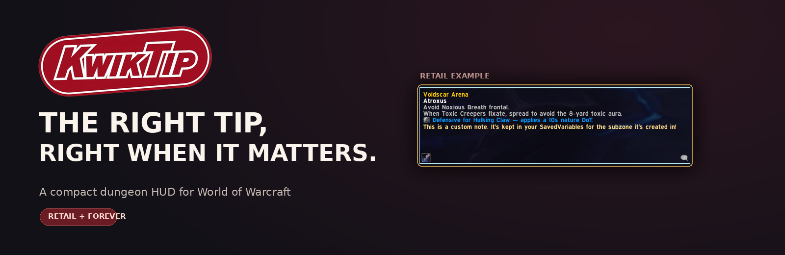
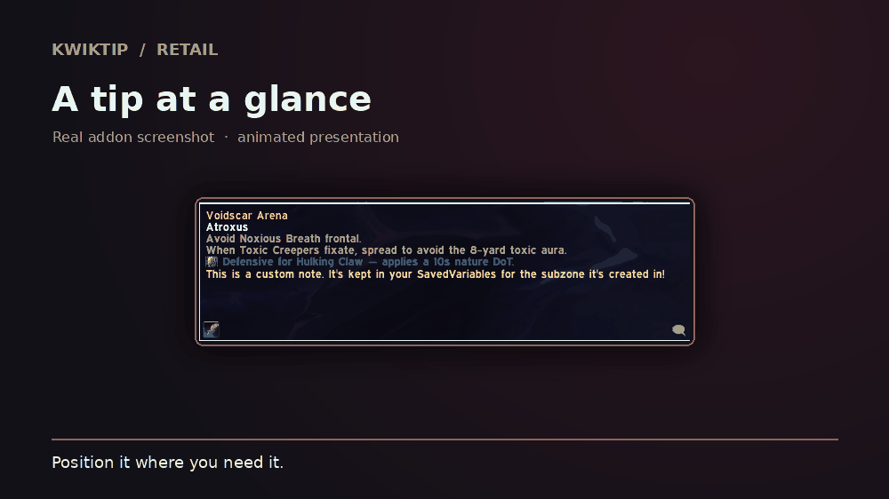
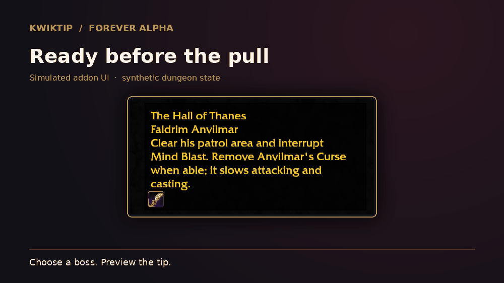

<p align="center">
  
</p>

# KwikTip

**The right tip, right when it matters.**

KwikTip puts short encounter reminders in a movable in-game HUD, so your group can stay focused on the fight. There are separate editions for World of Warcraft: Retail and WoW Forever.

Inspired by QE Dungeon Tips by QEdev.

## Pick your edition

| | Retail | WoW Forever |
|---|---|---|
| **Package** | `KwikTip` | `KwikTip_Forever` |
| **Release** | v3.5.0 | 0.1.0-alpha.7 |
| **Download** | [CurseForge](https://www.curseforge.com/wow/addons/kwiktip) · [Wago](https://addons.wago.io/addons/kwiktip) · [WoWInterface](https://www.wowinterface.com/downloads/info27074-KwikTip.html) | [GitHub](https://github.com/postblink/KwikTip/releases/tag/forever-v0.1.0-alpha.7) · [Wago alpha](https://addons.wago.io/addons/kwiktip/versions?stability=alpha) · [CurseForge files](https://www.curseforge.com/wow/addons/kwiktip/files) |
| **Good to know** | Tips for selected dungeons, raids, delves and Timewalking content. | Partial Normal-mode dungeon coverage; the alpha is still being verified in game. |

CurseForge and Wago list the editions on the same project page. For Forever, select a file marked **Forever** and **Alpha**; CurseForge may require **Show alpha files**. WoWInterface distributes the Retail edition.

## See it in action

### Retail



*An animated presentation of a Retail screenshot, not gameplay footage.*

### Forever



*Rendered from the actual Forever addon in an offline simulator with synthetic dungeon state. This is not a gameplay capture.*

<details>
<summary>More Retail screenshots</summary>


</details>

## Retail

KwikTip surfaces authored tips for supported encounters and mapped areas. Depending on the content, you may see boss mechanics, trash priorities, and notes for tanks, healers or damage dealers.

- **Mapped areas:** the HUD can change as you move through supported subzones, including some boss rooms before the pull.
- **Mythic+:** see active affix tips and Blizzard's banked Enemy Forces progress when available.
- **Raids and delves:** use encounter guidance in supported content; delve tips are opt-in.
- **Timewalking:** selected tips are available across registered dungeons, but coverage is incomplete.

Retail v3.5.0 targets patch 12.1.0. Content and area detection vary by instance; not every boss or trash pack has a tip.

## WoW Forever

The Forever alpha brings the same compact HUD to Normal-mode dungeons with its own encounter data. It is a separate package, not the Retail addon renamed.

- **Prepare between fights:** enable **Persistent Tip Window** to see dungeon-wide preparation and trash advice.
- **Preview before the pull:** choose a boss in settings or use `/kwik boss` in a supported dungeon.
- **During the fight:** a matching encounter event takes over the HUD. A manual preview clears when combat starts.

**Alpha limits:** coverage is partial and some optional encounters are not mapped. The addon does not automatically identify your wing, room or current trash pack, and it does not support alternate difficulty modes. Registered IDs were checked against readable client data from build 1.60.1.71037; those checks do not qualify newer build 1.60.1.71139. In-game display, persistence and encounter behavior have not yet been fully verified for this alpha.

The [Forever coverage ledger](Forever/Coverage.json) lists included encounters and exclusions, with [ID evidence](docs/FOREVER_CURRENT_IDS_71037.json) for the checked build.

## Make it yours

Both editions let you move and resize the HUD, adjust its appearance, keep personal notes alongside tips, and choose a chat channel for the HUD's send button. Optional LibSharedMedia support adds fonts from your other addons; built-in fonts work without it.

Open settings with `/kwik` or the minimap button. The bundled interface includes German localization; authored tips remain in English where a translation is unavailable.

## Installation

1. Download the package for your edition from the table above.
2. Extract the addon folder into the matching client directory:

   ```text
   World of Warcraft/_retail_/Interface/AddOns/KwikTip
   World of Warcraft/_forever_/Interface/AddOns/KwikTip_Forever
   ```

3. Enable the matching addon on the character selection screen. After updating Lua files while logged in, `/reload` normally loads the update.

For Forever, use the packaged ZIP: the repository's `Forever/` source folder alone does not contain the complete addon. An existing character can retain its previous addon enablement setting.

## Commands

| Command | What it does |
|---|---|
| `/kwik` or `/kwiktip` | Open settings. |
| `/kwik move` | Show and move or resize the HUD. |
| `/kwik preview` | Preview the role-note display. |
| `/kwik boss` | **Forever:** list available bosses in a supported dungeon. |
| `/kwik boss <number or name>` | **Forever:** preview a boss tip before the pull. |
| `/kwik boss clear` | **Forever:** dismiss the manual boss preview. |
| `/kwik debug` | Print the current instance detection state. |
| `/kwik feedback` | Show the feedback link. |
| `/kwik help` | List available commands. |

## Feedback

Found a missing tip or a mechanic that needs a correction? [Open an issue](https://github.com/postblink/KwikTip/issues) and include the edition, dungeon, boss, and what happened. Please don't post your full SavedVariables files; they can contain personal notes and other logs.

KwikTip is free and open source under the [GPL-3.0 license](LICENSE).
